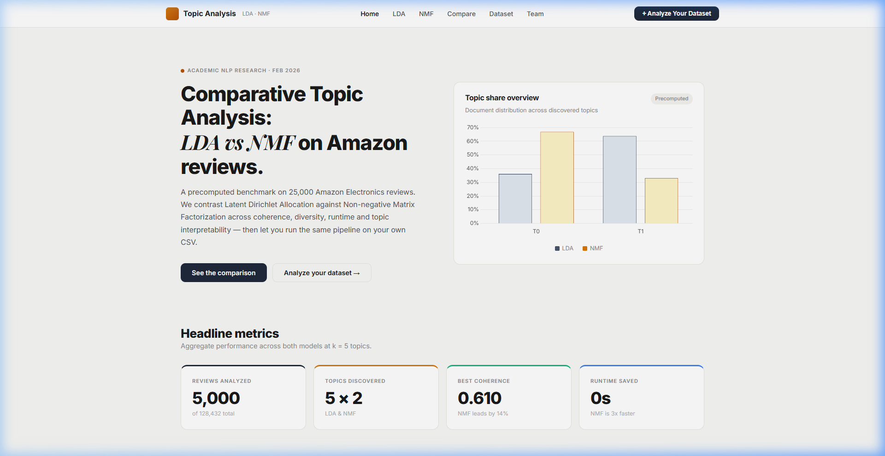
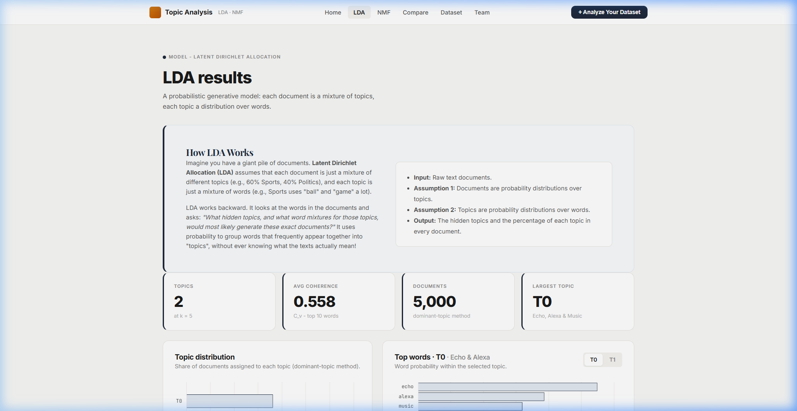
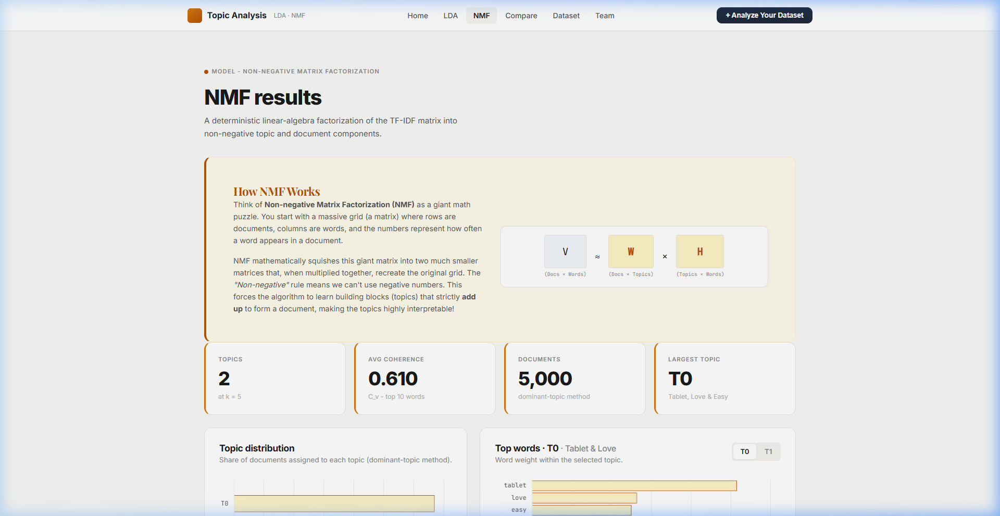
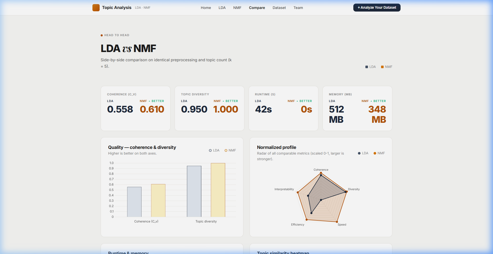
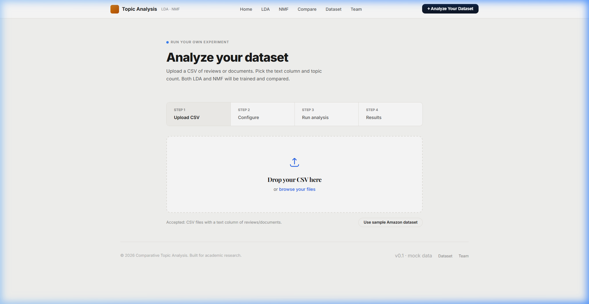

# Topic Modeling Dashboard

A topic modeling dashboard that evaluates and compares Latent Dirichlet Allocation (LDA) vs Non-Negative Matrix Factorization (NMF) on Amazon product reviews. Supports native deployment on **Streamlit Community Cloud**, **Docker**, **Render**, or as a standalone application.

## Demo Video
See the dashboard in action below! It demonstrates the topic analysis overview, comparing models, and testing custom datasets.


## Screenshots

### 1. Main Dashboard Overview
Provides a high-level view of topics extracted, model runtimes, and a comparative overview.


### 2. LDA Model Insights
Dive deep into topics extracted specifically by the LDA model, including top words and documents.


### 3. NMF Model Insights
Explore the alternative perspectives and word distributions generated by the NMF model.


### 4. Head-to-Head Evaluation
Detailed metrics and matrix breakdowns comparing LDA against NMF on coherence and diversity.


### 5. Custom Dataset Upload / Live Scraper
Analyze your own text data seamlessly by dropping a CSV file or providing e-commerce product URLs (Flipkart, Snapdeal, Myntra, Amazon).


## Getting Started

### 1. Install dependencies
Ensure you have all the required Python packages installed:
```bash
pip install -r requirements.txt
playwright install chromium
```

### 2. Run as a Streamlit Application (Recommended for Streamlit Deployment)
Run using the standard Streamlit CLI:
```bash
streamlit run streamlit_app.py
```
*(Or alternatively: `streamlit run app.py`)*

Then open `http://localhost:8501` in your web browser.

### 3. Streamlit Cloud Deployment
1. Connect your GitHub repository to [Streamlit Community Cloud](https://share.streamlit.io).
2. Set the **Main file path** to `streamlit_app.py` (or `app.py`).
3. Deploy! All dependencies in `requirements.txt` and `.streamlit/config.toml` are configured automatically.

### 4. Run Standalone (Flask Mode)
You can also run directly with Flask:
```bash
python app.py
```
Then navigate to `http://127.0.0.1:5000` in your web browser.
